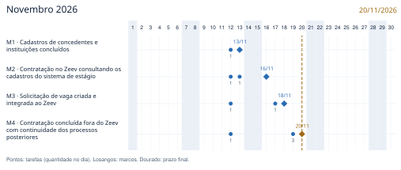

# Migração do Zeev até a contratação de estagiários

Versão 1

Concluir os cadastros de concedente e instituição de ensino, criar a solicitação de vaga e concluir a contratação no sistema de estágio até 20/11/2026, mantendo as consultas e integrações necessárias aos processos que continuam no Zeev.

20/11/2026

## Fase 1. Concluir os cadastros

Previsão: até 13/11

### Cadastros de concedentes e instituições concluídos

Dados importados do Zeev consolidados e novos cadastros realizados somente no sistema de estágio.

#### T1 · Concilie os dados importados dos dois cadastros

- ID: `T01`.
- Responsável: DONO A DEFINIR (TI).
- Execução: Desenvolvimento com apoio de Codex ou Dot.
- Previsão: 12/11/2026.

**Pronto quando:** Relação de registros importados, faltantes, duplicados e divergentes disponível para os dois cadastros.

- Compare os registros de concedentes e instituições do Zeev com os importados no sistema de estágio.
- Registre divergências, identificadores de origem e ajustes necessários sem descartar dados sem decisão.

Entregas: Relação de registros importados, faltantes, duplicados e divergentes disponível para os dois cadastros.

#### T2 · Consolide os cadastros no sistema de estágio

- ID: `T02`.
- Responsável: DONO A DEFINIR (TI).
- Execução: Desenvolvimento com apoio de Codex ou Dot.
- Previsão: 13/11/2026.
- Depende de: T1.

**Pronto quando:** Divergências tratadas ou encaminhadas para decisão; dados necessários ao uso dos dois cadastros completos.

- Obtenha decisão da gestão para conflitos que dependam de interpretação.
- Aplique os ajustes e confira vínculos e identificadores dos registros afetados.
- Confirme que os novos registros serão mantidos no sistema de estágio.

Entregas: Divergências tratadas ou encaminhadas para decisão; dados necessários ao uso dos dois cadastros completos.

#### T3 · Valide os cadastros consolidados

- ID: `T03`.
- Responsável: DONO A DEFINIR (gestão de estágios).
- Execução: Participação humana.
- Previsão: 13/11/2026.
- Depende de: T2.

**Pronto quando:** Gestão de estágios aceita os dois cadastros e registra eventuais impedimentos de uso.

- Confira os casos divergentes tratados e os dados usados na contratação.
- Confirme a orientação de cadastrar concedentes e instituições somente no sistema de estágio.

Entregas: Gestão de estágios aceita os dois cadastros e registra eventuais impedimentos de uso.

## Fase 2. Manter a contratação no Zeev durante a transição

Previsão: até 16/11

### Contratação no Zeev consultando os cadastros do sistema de estágio

Durante a transição, o processo de contratação no Zeev obtém concedente e instituição de ensino no sistema de estágio.

#### T4 · Especifique a consulta de cadastros pelo Zeev

- ID: `T04`.
- Responsável: DONO A DEFINIR (TI).
- Execução: Desenvolvimento com apoio de Codex ou Dot.
- Previsão: 12/11/2026.
- Depende de: T1.

**Pronto quando:** Campos, identificadores, permissões e comportamento de consulta documentados para os dois cadastros.

- Identifique os dados exigidos pelo processo atual de contratação no Zeev.
- Registre como localizar e selecionar um concedente e uma instituição no sistema de estágio.
- Confirme acessos, credenciais e comportamento em caso de indisponibilidade.

Entregas: Campos, identificadores, permissões e comportamento de consulta documentados para os dois cadastros.

#### T5 · Implemente a consulta no processo atual do Zeev

- ID: `T05`.
- Responsável: DONO A DEFINIR (TI).
- Execução: Desenvolvimento com apoio de Codex ou Dot.
- Previsão: 13/11/2026.
- Depende de: T4.

**Pronto quando:** Contratação no Zeev consulta e seleciona os dois cadastros mantidos no sistema de estágio.

- Disponibilize a consulta no sistema de estágio e configure seu consumo no Zeev.
- Vincule os identificadores selecionados ao processo e trate falhas de comunicação.
- Verifique os casos de consulta, seleção e indisponibilidade com evidências.

Entregas: Contratação no Zeev consulta e seleciona os dois cadastros mantidos no sistema de estágio.

#### T6 · Valide a continuidade da contratação no Zeev

- ID: `T06`.
- Responsável: DONO A DEFINIR (gestão de estágios).
- Execução: Participação humana.
- Previsão: 16/11/2026.
- Depende de: T3, T5.

**Pronto quando:** Gestão de estágios confirma que a contratação atual usa os cadastros consolidados sem exigir cadastro duplicado no Zeev.

- Realize um caso representativo de contratação no Zeev com concedente e instituição do sistema de estágio.
- Registre o resultado e os impedimentos encontrados.

Entregas: Gestão de estágios confirma que a contratação atual usa os cadastros consolidados sem exigir cadastro duplicado no Zeev.

## Fase 3. Entregar a solicitação de vaga

Previsão: até 18/11

### Solicitação de vaga criada e integrada ao Zeev

Novo módulo recebe as solicitações feitas no Zeev e disponibiliza as vagas para originar contratações.

#### T7 · Confirme os dados e as regras da solicitação de vaga

- ID: `T07`.
- Responsável: DONO A DEFINIR (gestão de estágios).
- Execução: Participação humana.
- Previsão: 12/11/2026.

**Pronto quando:** Campos, estados e condições para uma vaga originar contratação registrados pela gestão de estágios.

- Descreva os dados da solicitação atual no Zeev e o que deve aparecer no novo módulo.
- Confirme o momento de entrada e de liberação da vaga para contratação.
- Informe os vínculos necessários com concedente e instituição, se aplicáveis.

Entregas: Campos, estados e condições para uma vaga originar contratação registrados pela gestão de estágios.

#### T8 · Crie o módulo de solicitação de vaga

- ID: `T08`.
- Responsável: DONO A DEFINIR (TI).
- Execução: Desenvolvimento com apoio de Codex ou Dot.
- Previsão: 17/11/2026.
- Depende de: T7.

**Pronto quando:** Módulo criado do zero permite localizar e consultar vagas com os dados e regras confirmados.

- Implemente o registro, a consulta e os controles de acesso necessários.
- Disponibilize o identificador da vaga para o módulo de contratação.
- Verifique as regras confirmadas com casos representativos.

Entregas: Módulo criado do zero permite localizar e consultar vagas com os dados e regras confirmados.

#### T9 · Integre as solicitações de vaga do Zeev

- ID: `T09`.
- Responsável: DONO A DEFINIR (TI).
- Execução: Desenvolvimento com apoio de Codex ou Dot.
- Previsão: 18/11/2026.
- Depende de: T8.

**Pronto quando:** Solicitações feitas no Zeev aparecem no módulo de vagas com identificação da origem e sem duplicação em reenvios.

- Configure o envio pelo Zeev e a recepção pelo sistema de estágio.
- Vincule os identificadores e registre falhas para permitir correção e reprocessamento.
- Verifique entrada, reenvio e recuperação de falha.

Entregas: Solicitações feitas no Zeev aparecem no módulo de vagas com identificação da origem e sem duplicação em reenvios.

#### T10 · Valide o recebimento e o uso das vagas

- ID: `T10`.
- Responsável: DONO A DEFINIR (gestão de estágios).
- Execução: Participação humana.
- Previsão: 18/11/2026.
- Depende de: T9.

**Pronto quando:** Gestão de estágios confirma que a solicitação do Zeev aparece corretamente e está disponível para originar contratação.

- Faça uma solicitação representativa no Zeev e localize o registro no sistema de estágio.
- Confira dados, vínculo de origem e condição de uso na contratação.

Entregas: Gestão de estágios confirma que a solicitação do Zeev aparece corretamente e está disponível para originar contratação.

## Fase 4. Migrar a contratação e confirmar a continuidade

Prazo final: 20/11

### Contratação concluída fora do Zeev com continuidade dos processos posteriores

Contratação realizada no sistema de estágio a partir da vaga e dos dois cadastros; processos que permanecem no Zeev permitem selecionar os contratos registrados no sistema de estágio.

#### T11 · Liste as pendências da contratação já implementada

- ID: `T11`.
- Responsável: DONO A DEFINIR (TI).
- Execução: Desenvolvimento com apoio de Codex ou Dot.
- Previsão: 12/11/2026.

**Pronto quando:** Lista verificável do que funciona e do que falta para concluir uma contratação no sistema de estágio.

- Examine a implementação existente sem presumir que os fluxos estão concluídos.
- Percorra o fluxo disponível e registre impedimentos, regras faltantes e dependências externas.
- Separe correções necessárias ao objetivo de melhorias que podem ficar para depois.

Entregas: Lista verificável do que funciona e do que falta para concluir uma contratação no sistema de estágio.

#### T12 · Conclua o fluxo de contratação no sistema de estágio

- ID: `T12`.
- Responsável: DONO A DEFINIR (TI).
- Execução: Desenvolvimento com apoio de Codex ou Dot.
- Previsão: 19/11/2026.
- Depende de: T11, T3, T8.

**Pronto quando:** Fluxo permite concluir contratação a partir de uma vaga e associar concedente e instituição com os dados necessários.

- Implemente as pendências necessárias identificadas no levantamento.
- Conecte a contratação à vaga e aos dois cadastros.
- Verifique regras, documentos e integrações exigidos pelo fluxo confirmado.

Entregas: Fluxo permite concluir contratação a partir de uma vaga e associar concedente e instituição com os dados necessários.

#### T13 · Disponibilize os contratos para consulta pelo Zeev

- ID: `T13`.
- Responsável: DONO A DEFINIR (TI).
- Execução: Desenvolvimento com apoio de Codex ou Dot.
- Previsão: 19/11/2026.
- Depende de: T12.

**Pronto quando:** Zeev pode localizar contratos do sistema de estágio e obter o identificador necessário para vinculá-los aos seus processos.

- Defina os dados de identificação e as permissões para consulta dos contratos.
- Disponibilize a consulta e verifique busca e retorno dos contratos disponíveis.

Entregas: Zeev pode localizar contratos do sistema de estágio e obter o identificador necessário para vinculá-los aos seus processos.

#### T14 · Configure a seleção de contratos nos processos do Zeev

- ID: `T14`.
- Responsável: DONO A DEFINIR (TI).
- Execução: Desenvolvimento com apoio de Codex ou Dot.
- Previsão: 19/11/2026.
- Depende de: T13.

**Pronto quando:** Processos posteriores que continuam no Zeev permitem selecionar um contrato do sistema de estágio, incluindo a solicitação de rescisão.

- Identifique com a gestão quais processos existentes precisam dessa seleção para manter a continuidade.
- Configure o consumo da consulta e o vínculo com o contrato selecionado.
- Verifique a seleção e a preservação do vínculo sem migrar os módulos posteriores.

Entregas: Processos posteriores que continuam no Zeev permitem selecionar um contrato do sistema de estágio, incluindo a solicitação de rescisão.

#### T15 · Homologue a contratação e a continuidade no Zeev

- ID: `T15`.
- Responsável: DONO A DEFINIR (gestão de estágios).
- Execução: Participação humana.
- Previsão: 20/11/2026.
- Depende de: T6, T10, T12, T14.

**Pronto quando:** Gestão de estágios aceita o cenário de vaga recebida do Zeev, contratação no novo sistema e seleção do contrato em processo posterior no Zeev.

- Execute o cenário completo com os dados e acessos necessários.
- Confira os dados do contrato e sua seleção na solicitação de rescisão no Zeev, sem concluir uma rescisão real para testar.
- Registre o aceite ou os bloqueios e confirme a data de mudança da operação.

Entregas: Gestão de estágios aceita o cenário de vaga recebida do Zeev, contratação no novo sistema e seleção do contrato em processo posterior no Zeev.

#### T16 · Publique a mudança da contratação para o novo sistema

- ID: `T16`.
- Responsável: DONO A DEFINIR (TI).
- Execução: Desenvolvimento com apoio de Codex ou Dot.
- Previsão: 20/11/2026.
- Depende de: T15.

**Pronto quando:** Versão validada disponível no ambiente de uso e entrada de novas contratações direcionada ao sistema de estágio.

- Publique os componentes e configurações validados conforme os acessos e autorizações do ambiente.
- Oriente a entrada de novas contratações e preserve os processos em andamento conforme decisão da gestão.
- Mantenha as consultas necessárias aos processos que continuam no Zeev.

Entregas: Versão validada disponível no ambiente de uso e entrada de novas contratações direcionada ao sistema de estágio.

#### T17 · Confirme o uso após a mudança

- ID: `T17`.
- Responsável: DONO A DEFINIR (gestão de estágios).
- Execução: Participação humana.
- Previsão: 20/11/2026.
- Depende de: T16.

**Pronto quando:** Gestão de estágios confirma que a contratação está disponível fora do Zeev e que o Zeev consulta os contratos para os processos mantidos.

- Confira a operação no ambiente publicado com um caso autorizado.
- Registre o aceite final, a evidência da entrega e qualquer pendência remanescente fora do escopo.

Entregas: Gestão de estágios confirma que a contratação está disponível fora do Zeev e que o Zeev consulta os contratos para os processos mantidos.

## Limites

- Escopo: cadastros de concedente e instituição de ensino, solicitação de vaga, contratação e integrações com o Zeev necessárias a essas entregas.
- Concedentes e instituições são cadastrados somente no sistema de estágio. Durante a transição, a contratação no Zeev consulta esses cadastros.
- Solicitações de vaga feitas no Zeev devem aparecer no sistema de estágio; o módulo de vagas será criado do zero.
- A contratação existente tem implementação parcial informada; sua prontidão e suas pendências ainda precisam ser verificadas.
- Declaração, relatório, recesso, aditivo, mudança de local ou período, rescisão e encerramento, e troca de carga horária ou vaga não serão migrados neste plano. Os processos mantidos no Zeev devem consultar os contratos do sistema de estágio.
- A importação dos estagiários existentes na contabilidade e a formação da base histórica ficam para outra etapa; são diferentes da consolidação dos dois cadastros importados do Zeev.
- Integração com o SGP fica para uma etapa futura.

## Quando ajustar

- Na revisão proposta de 13/11, se houver impedimentos de acesso, capacidade insuficiente ou pendências de contratação incompatíveis com 20/11, apresentar o impacto e uma decisão de prioridade ao responsável; não alterar o prazo confirmado sem nova decisão.
- Se houver divergências de dados que impeçam a seleção correta de concedente ou instituição, resolver os registros afetados antes de liberar o uso.
- Se o cenário integrado de contratação e consulta do contrato pelo Zeev falhar, corrigir e verificar antes de direcionar novas contratações ao novo sistema.

Próxima revisão: 13/11/2026 (proposta; a confirmar).

## LINHA DO TEMPO

Dias de entrega por mês; os marcadores não representam duração das tarefas.

### Novembro 2026

